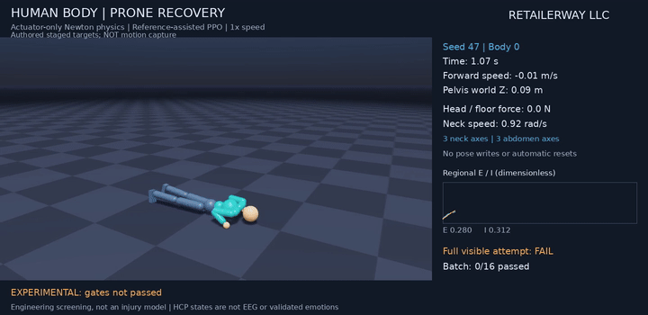
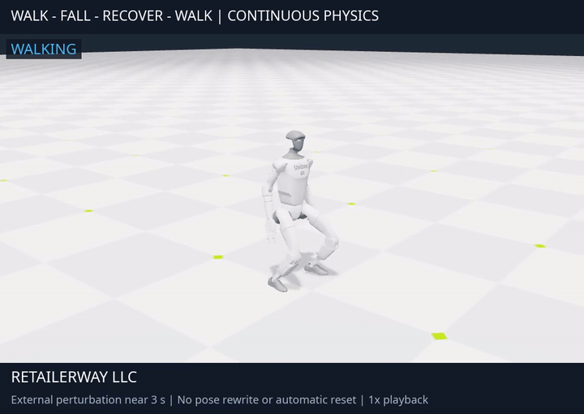
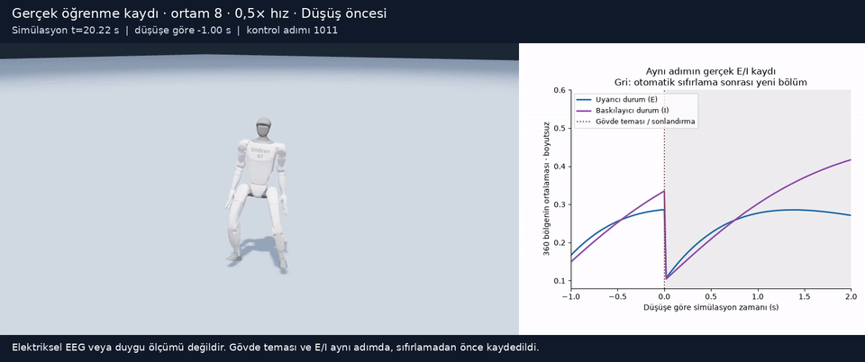
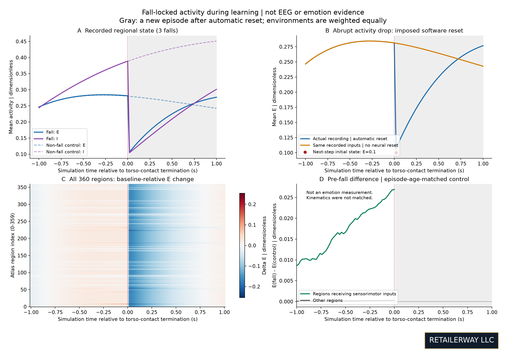
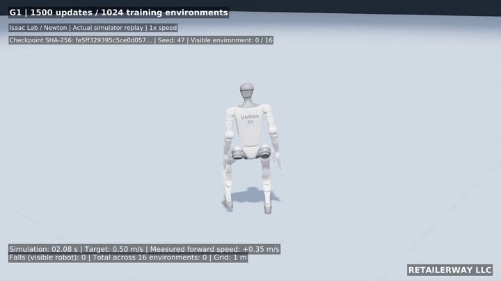

# Human Brain Model — Visual Evidence Archive

**RETAILERWAY LLC**

Reports, scientific figures, and recorded simulations from a pilot study of
human-connectivity-informed regional dynamics alongside a virtual body's
walking policy. Experiment date: **November 5, 2026**.

**This repository contains documentation and evidence media only. Project source
code, training scripts, model weights, and raw brain data are not published.**

## Articulated human motion — November 6

A new human research body adds three neck axes, an articulated trunk,
self-collisions and actual head-contact measurements. Natural human walking
and recovery remain **experimental: 0/48 final attempts qualified for each**.
The earlier robot success rates below do not establish human neck safety.

[Actual recovery prototype](videos/human-recovery-prototype.mp4) ·
[Actual walking prototype](videos/human-walking-prototype.mp4) ·
[Authored target replay — not learned physics](videos/human-getup-reference.mp4) ·
[Human motion report and remaining failures](docs/human-motion.md).

## Running, stairs and recovery

These are **robot-body task results**. Its fixed head joint and disabled
self-collisions do not validate human recovery or neck safety. A separate
[articulated human motion experiment](docs/human-motion.md) adds a moving
neck, trunk articulation, self-collisions and measured head-contact checks.

| New motor skill | Primary first-attempt result |
| --- | --- |
| Running | **40/48** |
| Four physical 8 cm steps | **44/48** |
| Getting up: supine and prone | **96/96** |

[Continuous fall-and-recovery video](videos/continuous-fall-recovery.mp4)
· [Running](videos/running-with-activity.mp4)
· [Stair ascent](videos/stairs-with-activity.mp4)
· [Getting up](videos/recovery-with-activity.mp4)
· [Full motor skill report](docs/motor-skills.md)
· [Per-attempt results](metadata/motor-skills.json).

The continuous episode contains **900 control steps with no pose rewrite or
automatic reset**. An explicit external disturbance caused the fall.
Across all retained native capture and primary conditions, running passed
66/80 and stair ascent 58/64; the weaker capture batches remain included.
These are simulator development gates, not general human-brain or hardware
capability claims. All new recordings play at 1× speed.

## A fall and its synchronized regional activity

[Watch / download the video](https://github.com/Aby0302/human-brain-model-evidence/releases/download/evidence-2026-11-05-en/fall-with-activity.mp4)
· [Full 28.8-second learning capture](videos/fall-learning-raw.mp4)
· [All media](docs/media-catalog.md)

The motion comes from a recorded physics simulation and its motor policy.
The curves show the visible body's regional E/I activity from **the same
control step, recorded before automatic reset**. The short clip plays at
**0.5× speed**, displaying three seconds of simulation over 6.04 seconds.
All published figures, videos, and GIFs carry the **RETAILERWAY LLC** stamp.

## Observations

| Investigation | Scope | Observation |
| --- | --- | --- |
| Primary fall analysis | 32 environments, 60 additional learning updates, 46,080 environment steps | 3 falls in 3 environments; 360 regions' E/I activity recorded at 50 Hz. |
| Separate learning capture | A separate 32-environment, 60-update run | 6 falls overall; 1 fall in visible environment 8. Counts were not pooled with the primary analysis. |
| Final walking-policy evaluation | 3 evaluation seeds, 16 environments each, 20 s per environment | 1 fall across 960 aggregate simulation seconds; mean forward speed approximately 0.349 m/s against a 0.5 m/s target. |
| Human EEG reference | 20 participants, 962 published trials | Actual Cz EEG aligned to support-surface perturbations, rather than robot impact or an emotion-labeled fall task. |

In the earlier learning study, regions receiving sensorimotor inputs differed from
age-matched non-fall controls. In those learning captures, the abrupt activity drop after a fall comes
from an **imposed software reset**. It cannot be interpreted as fear, pain,
or another measured emotion.

**Human-like electrical or emotional signaling has not been established.**
Model outputs are dimensionless regional states; the human reference is EEG
in microvolts. Biological time calibration, an EEG observation model, and
independent affect labels are absent, so no human-similarity score is reported.

## Figures and reports

[Experiment report](docs/experiment-report.md)
· [Methods and limitations](docs/methods-and-limitations.md)
· [Human EEG reference](images/human-eeg-reference.png)
· [Sources](docs/sources.md)

[Early and final policies, side by side](videos/walking-comparison.mp4).
These walking videos are re-executions of saved policies, captured after the
original training. Their different training budgets do not isolate the
independent benefit of the connectivity-informed features.

## Integrity and publication scope

Video durations, frame counts, and SHA-256 digests appear in the
[media manifest](metadata/media-manifest.json). Selected numerical results
are in the [results summary](metadata/results.json). Published-file hashes
are listed in [SHA256SUMS](SHA256SUMS).

English labels and RETAILERWAY LLC branding were added to the recorded evidence;
the experiment results and event timing were retained. The full learning
recording includes a branding footer, so its published copy is not the
unannotated original capture.

The repository alone cannot reproduce training because source code and weights
remain private. [Publication scope](PUBLICATION.md).
