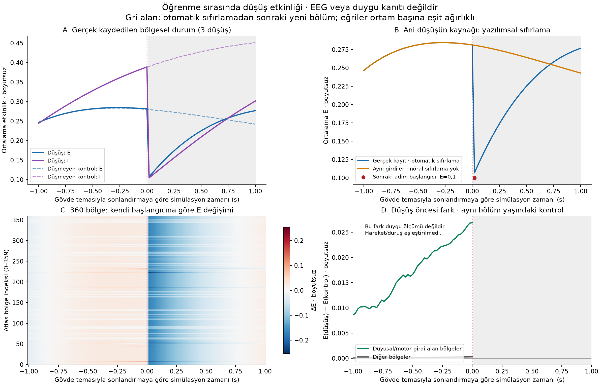
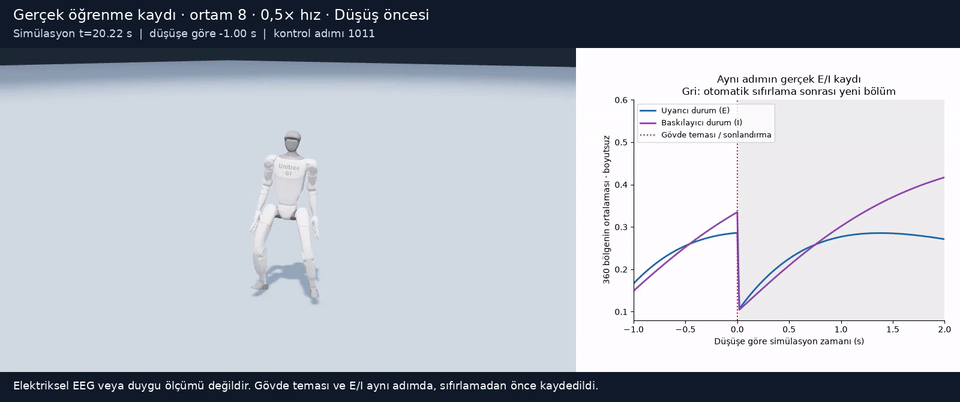
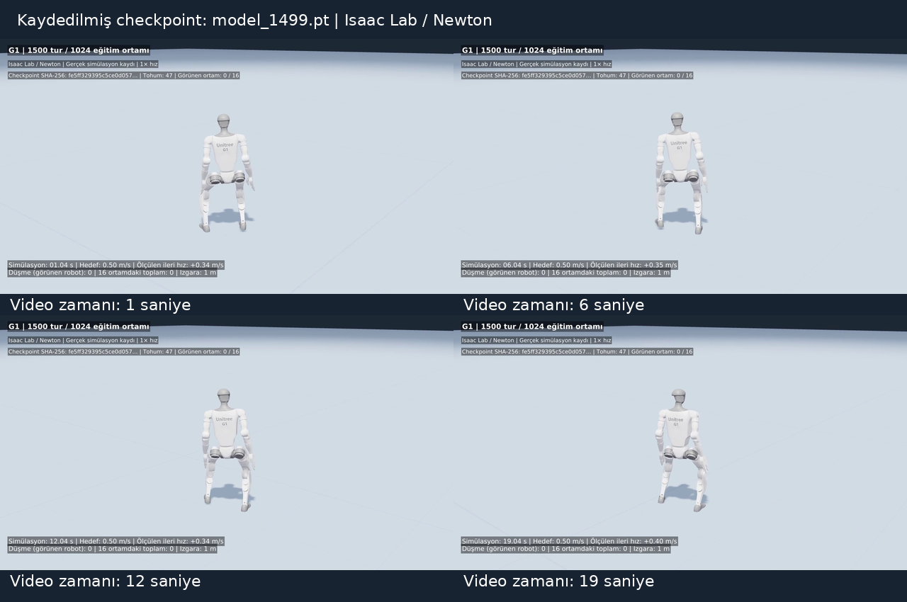
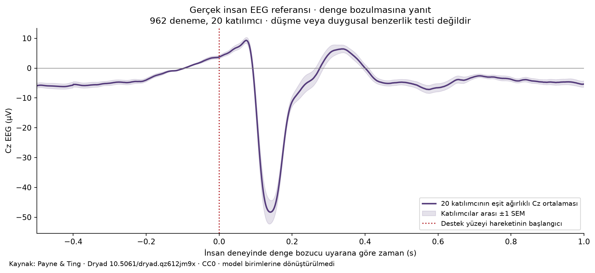

# Yürüme öğrenimi ve düşüşte bölgesel etkinlik

5 Kasım 2026 tarihli pilot çalışma; yalnızca görsel kanıt ve sonuç yayını.

## Bulguların kapsamı

Çalışma, insan beyni bağlantı verisinden yararlanan 360 bölgeli bir etkinlik
modelini sanal Unitree G1 bedeniyle birlikte inceler. Bütün bir insan beyninin
sayısal kopyası veya doğrulanmış bir duygu sistemi olduğu iddia edilmez.
Öğrenen bileşen PPO motor politikasıdır; beyin bağlantı matrisi bu deneylerde
sabit tutulmuştur.

Ana izleme koşusunda, kısmen eğitilmiş motor politikasından devam edilerek
32 paralel ortamda 60 ek öğrenme güncellemesi tamamlandı. Her ortam 28,8 saniye
ilerledi: toplam 46.080 ortam adımı ve 921,6 simülasyon saniyesi. İleri hız
hedefi 0,5 m/s idi; dış itmeler kapatıldı. Üç ayrı ortamda 3 gövde temasıyla
sonlandırma ve ayrıca 32 süre dolumu kaydedildi.

Bu çalışmada düşüş, gövde teması nedeniyle bölümün sonlandırılmasıdır.
İlk denge kaybı anıyla aynı olay değildir. Her adımda, otomatik sıfırlamadan
önce, 360 bölgenin uyarıcı ve baskılayıcı durumları (E/I) 50 Hz'de kaydedildi.

## Düşüş çevresindeki etkinlik

Her düşüş için bir saniye öncesi ve bir saniye sonrası incelendi. Kontroller
tam aynı bölüm yaşında ve bu kayıtta aynı küresel öğrenme adımında seçildi.
Kontrol pencerelerinde düşüş ve bölüm sıfırlaması yoktur; aynı örnekler tekrar
kullanılmadı. Bölüm yaşı eşlemesi başlangıç geçişinin etkisini azaltır;
**hız, duruş ve rastlantısal motor eylemler eşleştirilmemiştir**.

| Düşen ortam | Bölüm yaşı | Sonlandırmada ortalama E | Sonlandırmada ortalama I | Duyusal/motor E'nin kontrolden farkı |
| --- | --- | --- | --- | --- |
| 8 | 1,46 s | 0,28657 | 0,36607 | +0,02737 |
| 26 | 1,64 s | 0,28368 | 0,38593 | +0,02786 |
| 2 | 1,96 s | 0,27384 | 0,41437 | +0,02542 |

Etkinlik değerleri ve farklar boyutsuzdur. Diğer bölgelerdeki ortalama E farkı
yaklaşık 0,000244–0,000320 aralığındadır. Duyusal/motor bölgelerdeki daha büyük
fark, hareket bilgisinin seçilmiş bölgelere aktarılmasıyla uyumludur. Üç olay
tek tohumdan ve tek öğrenme devamından geldiği için istatistiksel genelleme
veya yalnızca düşüşe özgü nedensel yanıt iddiası yapılmaz.

Üç düşüşün tamamında sonraki adım başlangıcında **E=I=0,1** doğrulandı.
Bu, ortamın model durumunu yeniden başlatmasıdır. Şeklin gri bölümündeki
örnekler yeni bir bölüme aittir; eski bedenin yerde kaldığı veya toparlandığı
kesintisiz bir gelecek göstermez.

Nöral sıfırlama kaldırılarak, aynı kaydedilmiş beden girdileriyle yapılan
çevrimdışı yeniden hesaplama düşüş öncesini en fazla 1,57×10⁻⁷ mutlak hatayla
yeniden üretti. Beden yeniden simüle edilmedi ve girdilerdeki fiziksel sıfırlama
korundu. Dolayısıyla bu eğri alternatif bir bedensel toparlanma değildir.

## Eşzamanlı video kanıtı

Video için **ayrı bir öğrenme koşusu** yapıldı: aynı başlangıç politikası ve
tohumla, 32 ortamda 60 güncelleme. Bu koşuda toplam 6 düşüş ve 32 süre dolumu
vardı; görüntülenen 8 numaralı ortam bir kez düştü. Olay 1061. kontrol
adımında, 21,22 simülasyon saniyesinde gerçekleşti.

Ham görüntü 50 kare/s hızında, sıfırlamadan önce alındı. Video karelerinin
kontrol adımları ile etkinlik örnekleri birebir eşleşti. Paylaşılan kısa klip
olayın 1 s öncesini ve 2 s sonrasını 0,5× hızda gösterir: 151 kare,
25 kare/s, 6,04 s. Ana üç olaylık analiz ile bu koşunun düşüş sayıları
birleştirilmedi. İkinci koşu bağımsız tohum doğrulaması değildir.

## Yürüme kayıtları

Erken politika 128 ortamda 100; son politika 1024 ortamda 1500 öğrenme
güncellemesiyle eğitildi. Kayıtlı politikaların yeniden yürütümlerinde,
görüntülenen robot erken kayıtta 10 saniyede 8 kez düştü; son kayıtta
20 saniye boyunca düşmedi ve ortalama yaklaşık 0,3533 m/s ileri hız yaptı.

Ayrı üç değerlendirme tohumu, 16'şar ortam ve ortam başına 20 s üzerinden,
son politika toplam 960 simülasyon saniyesinde 1 düşüş gösterdi. Ortalama
ileri hız yaklaşık 0,3491 m/s; hedef 0,5 m/s idi. Bunlar kısa pilot
değerlendirmeleridir. Farklı eğitim bütçeleri, bağlantı modelinin bağımsız
katkısını ayırmaz. Koşma ve tırmanma bu kayıtlarla doğrulanmamıştır.

## İnsan EEG'si ve duygusal yorum

Payne ve Ting'in açık denge verisinden, 20 katılımcının yayımlanmış
962 denemelik Cz EEG referansı çıkarıldı. Dosyanın gerçek zaman ekseni
−0,5 ile +2 s; örnekleme hızı 1000 Hz'dir. Önce her katılımcının denemeleri,
ardından katılımcılar eşit ağırlıkla ortalandı. Gölge katılımcılar arası
±1 standart hatayı gösterir. Ek filtreleme veya yeniden ölçekleme yapılmadı.

İnsan deneyindeki olay **destek yüzeyi hareketinin başlamasıdır**; robotun
yere temasıyla aynı olay ve duygusal etiketli düşüş deneyi değildir.
İnsan grafiği µV, model grafiği boyutsuzdur. Aralarında birim dönüştürülmedi.

Mevcut modelde voltaj ve biyolojik zaman kalibrasyonu, EEG ölçüm modeli ve
bağımsız duygu etiketleri bulunmuyor. Bu nedenle elektriksel/duygusal insan
benzerliği **değerlendirilemedi**. Bu sonuç belirli bir duygunun yokluğunun
kanıtı da değildir. İnsan denge deneyleri de erken denge yanıtı ile hata
işlemeyi ayrı incelemektedir. [Birincil kaynaklar](kaynaklar.md).

[Yöntem ve sınırlar](yontem-ve-sinirlar.md)
· [Sayısal özet](../metadata/results.json)
· [Medya kataloğu](gorsel-katalog.md)
