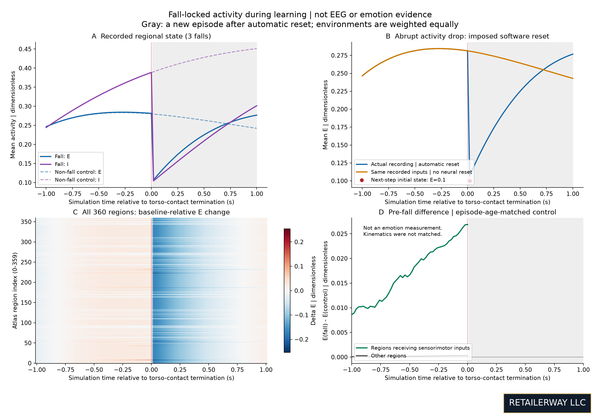
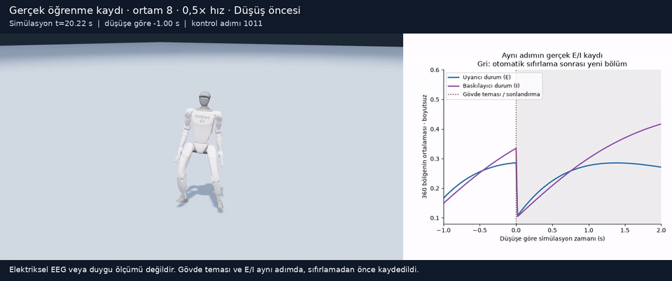
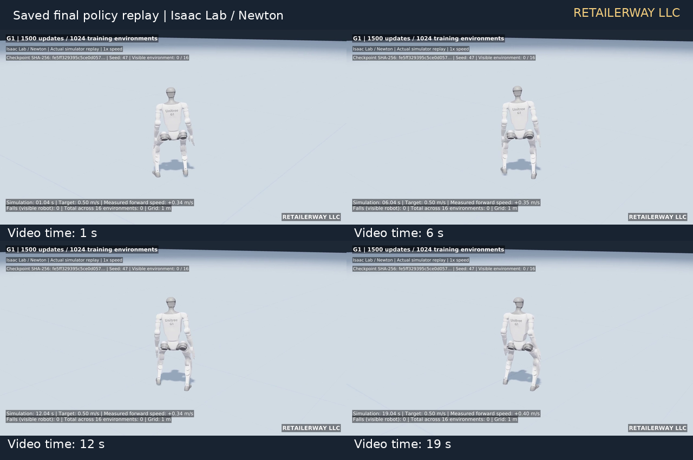
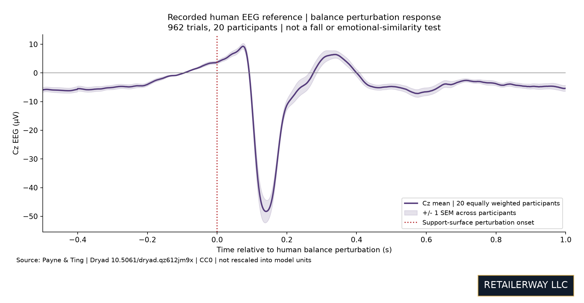

# Walking learning and regional activity around falls

**RETAILERWAY LLC** · November 5, 2026 · Pilot evidence report

## Scope

This study examines a 360-region activity model informed by human brain
connectivity alongside a virtual Unitree G1 body. It does not establish a
complete digital human brain or a validated emotion system. The PPO motor
policy learns; the connectivity matrix remains fixed in these experiments.

The primary monitoring run continued a partially trained motor policy for
60 additional updates across 32 environments. Each environment advanced
28.8 seconds: 46,080 environment steps and 921.6 aggregate simulation seconds.
The requested forward speed was 0.5 m/s, with external pushes disabled.
Three environments produced 3 torso-contact terminations; 32 timeouts were
counted separately.

A fall here means episode termination due to torso contact. It is not the
first instant of balance loss. Excitatory and inhibitory regional states
(E/I) were captured at 50 Hz, before automatic reset.

## Activity around falls

Each fall was examined from one second before to one second after termination.
Non-fall controls matched the exact episode age and, in this recording, the
same global learning step. Control windows contained neither falls nor episode
resets, and control samples were not reused. Age matching reduces the
startup-transient confound; **speed, posture, and stochastic motor actions were
not matched**.

| Falling environment | Episode age | Mean E at termination | Mean I at termination | Sensorimotor E minus control |
| --- | --- | --- | --- | --- |
| 8 | 1.46 s | 0.28657 | 0.36607 | +0.02737 |
| 26 | 1.64 s | 0.28368 | 0.38593 | +0.02786 |
| 2 | 1.96 s | 0.27384 | 0.41437 | +0.02542 |

All activity values and differences are dimensionless. Other regions' mean E
differences were approximately 0.000244–0.000320. The larger sensorimotor
difference is consistent with motion inputs being delivered to selected
regions. Three events from one seed and one continuation do not support
statistical generalization or a fall-specific causal-response claim.

All three falls were followed by **E=I=0.1 at the next step's start**. This is
an imposed state reset. Samples in the gray portion of the figure belong to
a new episode; they do not show uninterrupted physical recovery after impact.

An offline recalculation without neural resets, driven by the recorded body
inputs, reproduced pre-fall E with a maximum absolute error of 1.57×10⁻⁷.
The body was not re-simulated, and its actual physical reset remained in the
inputs. This curve is therefore not an alternative recovery trajectory.

## Synchronized video evidence

A **separate learning run** produced the video: the same initial policy and
seed, 32 environments, and 60 updates. It recorded 6 falls overall and
32 timeouts. Visible environment 8 fell once, at control step 1061 and
simulation time 21.22 seconds.

Images were captured at 50 frames/s before reset. Frame control steps matched
the activity samples exactly. The short clip shows 1 second before and
2 seconds after the event at 0.5× speed: 151 frames, 25 frames/s, 6.04 seconds.
Its counts were not combined with the primary three-event analysis. This
second run is not an independent-seed validation.

English annotations and RETAILERWAY LLC branding were applied to the original
recorded frames and synchronized measurements. The full-length capture has
only a branding/context footer added; the original private capture is retained
locally.

## Walking recordings

The early policy used 100 updates across 128 environments; the final policy
used 1,500 updates across 1,024 environments. In subsequent saved-policy
replays, the visible early-policy robot fell 8 times in 10 seconds. The
visible final-policy robot had no falls over 20 seconds and a mean forward
speed of approximately 0.3533 m/s.

Across three separate evaluation seeds, 16 environments each and 20 seconds
per environment, the final policy had 1 fall over 960 aggregate simulation
seconds. Mean forward speed was approximately 0.3491 m/s against the
0.5 m/s target. These are short pilot evaluations. Different training
budgets do not isolate the connectivity model's independent contribution.
Running and climbing were not validated by these recordings.

## Human EEG and emotional interpretation

A Cz EEG reference was derived from the 962 published trials of 20 participants
in Payne and Ting's open balance dataset. The inspected file spans
−0.5 to +2 seconds at 1,000 Hz. Trials were averaged within each participant,
then participant means were weighted equally. Shading shows ±1 standard error
across participants. No additional filtering or rescaling was applied.

The human event is **support-surface perturbation onset**, rather than robot
torso contact or an emotion-labeled fall. The human figure retains µV; the
model retains dimensionless units. Neither was converted into the other's
units.

The current model lacks voltage and biological-time calibration, an EEG
observation model, and independent affect labels. Electrical or emotional
human similarity therefore **could not be evaluated**. This is also not proof
that a particular emotion is absent. Human balance experiments distinguish
early perturbation responses from error processing. [Primary sources](sources.md).

[Methods and limitations](methods-and-limitations.md)
· [Numerical summary](../metadata/results.json)
· [Media catalog](media-catalog.md)
