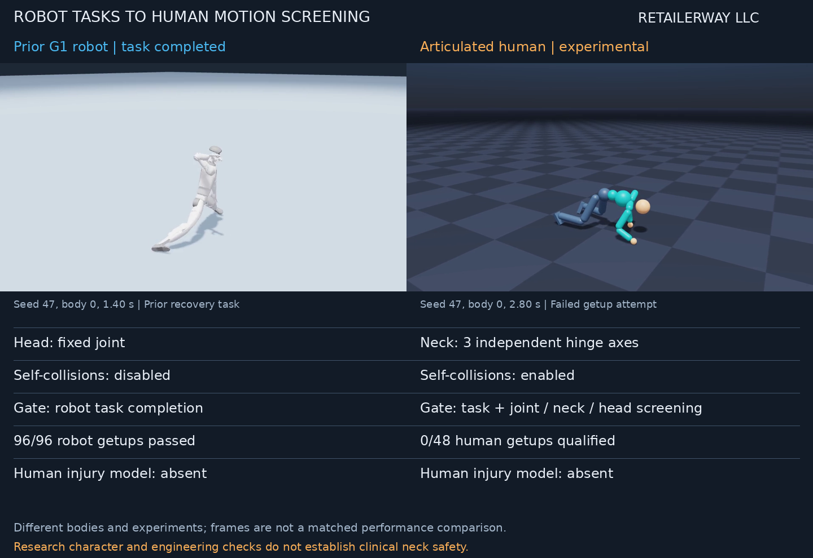
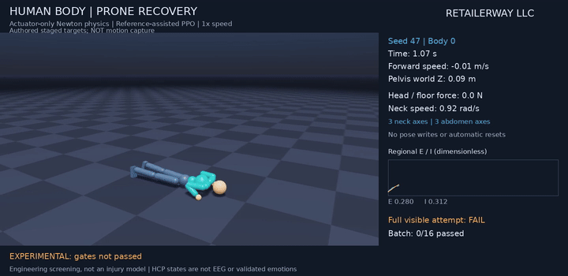
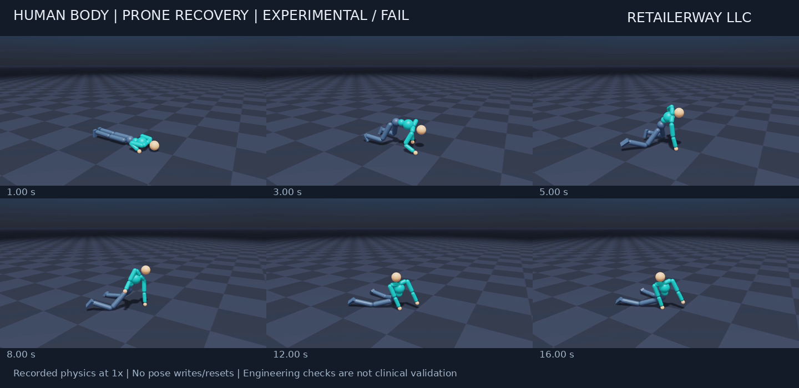
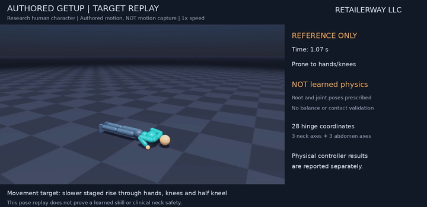

# Articulated human motion: progress and unresolved recovery

**RETAILERWAY LLC — November 5–6, 2026**

**Historical prototype:** this page preserves the earlier failed profile.
The [newer supported-recovery experiment](supported-getup.md) passed its
declared full-prone gates; its controller and results are documented separately.
The latest [walking and continuous recovery report](human-walk-recovery.md)
adds qualified nominal conditions and retains its stress failures.

A separate human research body now has a moving neck, articulated trunk,
self-collisions and measured head-contact screening. **Natural human walking
and recovery are not yet qualified.** The physical prototype can step and
shift support, but all final attempts failed at least one declared gate.
The recovery prototype rises toward hands and knees and does not finish standing.

The earlier G1 robot's 96/96 recovery result measured robot task completion.
Its fixed head joint and disabled self-collisions could not establish human
neck plausibility. No experiment here predicts whether a human neck would
fracture. The original robot policies and evidence have been retained.

## What changed

| Property | Previous G1 experiment | New human research branch |
| --- | --- | --- |
| Head / neck | Fixed head joint | Three independently limited hinge coordinates |
| Trunk | Robot waist | Three abdomen coordinates |
| Self-collisions | Disabled | Enabled |
| Movement guidance | Robot task rewards | Attributed walking reference; authored staged getup target |
| Acceptance | Robot task completion | Physical task plus measured joint, neck and head-contact screening |
| Clinical injury model | Absent | Absent |

The new character has 28 actuated hinge coordinates; its free root is
unactuated. NVIDIA Newton runs 240 Hz physics, with policy/control and recorded
measurements at 30 Hz. A new residual PPO policy receives 491 features,
including the existing fixed 360-region HCP features. G1 weights were not
transferred into the incompatible body. The company stamp identifies this
experiment and presentation, while third-party credits remain intact.

## Recorded physics and final development results

[Actual recovery prototype](../videos/human-recovery-prototype.mp4) ·
[Actual walking prototype](../videos/human-walking-prototype.mp4) ·
[Derived per-attempt results](../metadata/human-motion.json).

| Final policy, three seeds × 16 bodies | Physical task | Engineering trajectory screen | Both |
| --- | --- | --- | --- |
| Walking | 0/48 | 21/48 | **0/48** |
| Prone getup | 0/48 | 0/48 | **0/48** |

These are development conditions, using seeds 47, 97 and 131. Seeds were
reused during development; this is not an untouched robustness benchmark.
All final-policy conditions are included. The videos show body 0 of seed 47,
with its full-attempt **FAIL** label, at 1× speed. Each is one 16-second
episode with zero automatic resets and no pose writes after initialization.
They are saved-policy replays, rather than footage of live training updates.

Walking averaged 0.236 m/s across the final attempts. Upright posture failed
the required duration; some trials also failed speed, head/neck or joint
screening. Alternating foot contact alone did not qualify the movement.

In prone recovery, all 48 attempts passed the sustained-head-support and
sampled neck-speed checks. The largest recorded neck speed was 2.987 rad/s.
However, every attempt exceeded the 0.02 rad joint-bound tolerance, with a
worst sampled excess of 0.0364 rad. Pelvis height reached approximately
0.49 m, below the 0.75 m supported-standing requirement. **Avoiding sustained
head support did not make recovery successful or clinically safe.**

[Recovery measurements](../images/human-recovery-measurements.png) ·
[Walking measurements](../images/human-walking-measurements.png).
The panels include actual head-floor force, neck motion and synchronized
dimensionless regional E/I activity. Those states are not EEG voltage,
emotion, pain or consciousness measurements.

## Intended staged rise: reference only

[Authored reference replay](../videos/human-getup-reference.mp4) ·
[Reference sequence](../images/human-getup-reference-sequence.png).

The 7.5-second target passes through prone, hands/knees, kneeling, half-kneel
and standing. **It is authored, not motion capture.** This replay prescribes
root and joint poses and does not demonstrate balance, contact dynamics or a
learned recovery. Its 11-second video includes initial/final target holds.
It is deliberately separate from the failed physical prototype above.

The walking clip comes from DeepMimic and was retargeted with independent
head, hand and foot landmark checks. Downloaded getup clips exceeded the
chosen rig's ranges even after equivalent rotation-branch conversion, so
they were not silently accepted as anatomically valid targets.

## Gates, training and verification

The trajectory screen rejects sampled joint-bound excess above 0.02 rad,
sampled neck speed above 3 rad/s, and sustained head-floor support above 5 N
for at least 0.1 s after the initial grace period. These are engineering
development caps, not human injury thresholds. The solver's joint constraints
are compliant; bounded actuator targets do not guarantee bounded actual motion.
Substep force and velocity peaks are not captured by the 30 Hz recording.

Walking additionally requires mean forward speed at least 0.3 m/s after a
3-second warm-up, pelvis height at least 0.5 m after the first second,
root and torso upright cosines at least 0.9 for 95% of scored frames,
single-foot support from each foot for at least 5%, and no other floor
support above 5 N. Recovery starts after one second of actual settling from
an observed low, non-upright body. It must reach pelvis height at least 0.75 m,
upright root and torso, low vertical speed and foot support for two seconds
within 15 seconds. A termination during settling or a discontinuous episode
invalidates the first attempt. Evaluation continues without resetting failures.

Additional residual-policy training used 512 bodies, with 1,400 walking
updates (17,203,200 environment steps) and 1,800 getup updates (22,118,400
steps), initialized from earlier local human-body policies. Training completed;
qualification did not. Intermediate failed trials were retained locally.

An independent review caught a pelvis COM versus root-origin velocity mismatch.
Initialization and measurement now convert between those points explicitly.
Final evaluations were rerun with that correction. The retained checkpoints
were trained under the earlier convention and remain experimental; the fix
does not retrospectively validate their training. Quaternion orientation
tracking error, torques, saturation, target rates, neck acceleration and joint
jerk are also recorded in the derived results.

The final main suite passed 135 tests with 36 optional-runtime skips. The
simulation-compatible suite passed 164 tests; six existing neuroimaging test
files requiring absent libraries were covered in the main environment and
excluded there. Counts overlap. Real runtime tests verify articulation,
head-floor contact, motor action, zero root actuation, partial-reset isolation
and the rotating-pelvis velocity conversion. Review findings were fixed with
failing-then-passing regressions. These checks verify software behavior,
not human biology.

The remaining motor work is balance and support transfer through the rise,
joint-stop overshoot, and natural gait/posture. Neither a human-shaped body
nor smooth reference animation is evidence of a whole human brain, validated
emotional electrical signals, clinical neck safety or physical-world transfer.

Only selected English media, this report and derived numerical summaries
are published. Source, scripts, configurations, weights and raw motion,
brain and EEG data remain private. [Sources](sources.md) ·
[Publication scope](../PUBLICATION.md).
