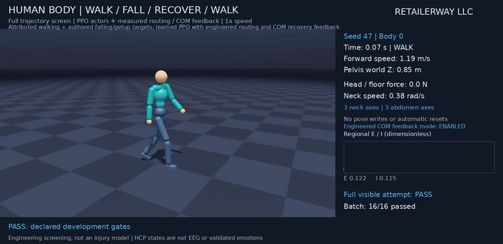
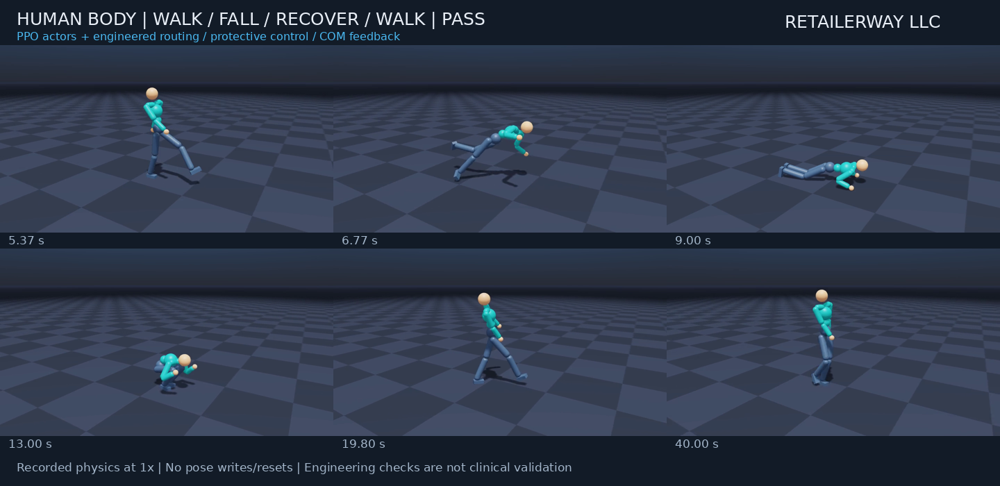
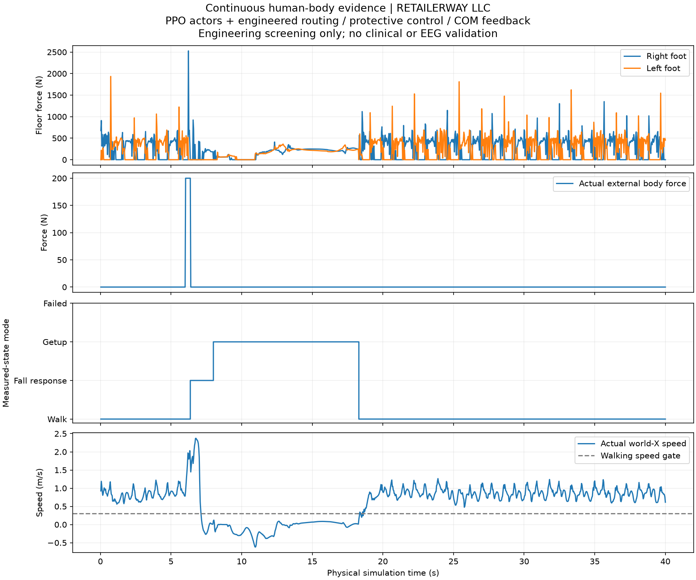

# Human walking and continuous fall recovery

**RETAILERWAY LLC — November 6, 2026**

The articulated research body now starts walking from stationary recovered
poses and completes **walk → external push → fall → getup → resumed walking**
in **48/48 nominal development attempts**, including the declared movement
screen. Harder conditions remain less reliable. These are simulation results,
not validated human injury safety, whole-brain learning or emotional EEG.

[Full 40-second physics recording](../videos/human-continuous-recovery.mp4) ·
[Standing-start walking video](../videos/human-walking-qualified.mp4) ·
[Derived results and retained failures](../metadata/human-walk-recovery.json).

## Results with frozen selected controllers

| Condition | Attempts passing task and movement screen |
| --- | --- |
| Earlier directed walking, initialized in motion | **48/48** |
| New walking, initialized stationary at recovered poses | **48/48** |
| Continuous nominal recovery: forward 200 N trunk pulse | **48/48** |
| Stronger forward 250 N trunk pulse | **8/16** |
| Diagonal trunk pulse: 200 N forward + 40 N lateral | **10/16** |
| Forward 200 N pulse delayed from 6 s to 9 s | **14/16** |

The nominal continuous row uses seeds 47, 97 and 131, with 16 bodies each.
The three stress rows use seeds 53, 79 and 83. Each pulse lasts 0.35 s.
All **96 frozen-pipeline continuous attempts** are retained: **80/96** pass
both the task and screen; **91/96** complete the functional sequence.
Standalone walking attempts are separate and are not pooled into these counts.
Development probes, including failed controllers and repeated replays, are
retained separately and are not an independent robustness benchmark.

These are parallel simulated bodies, not human participants. Ground is flat,
nominal initial heading is fixed, and initial root XY/joint perturbations
are ±0.02 m/±0.01 rad. Seeds and checkpoint selection were used during
development. Stationary-start tests use the same family of archived recovered
poses used in the start-up curriculum. No held-out human-motion claim is made.

The nominal standing hold qualifies at a median **18.3 s on the recording
timeline**, approximately 12.3 s after the pulse begins. Median resumed
world-X speed is approximately **0.86 m/s**. Every nominal attempt also has
qualified measured walking in its final three seconds.

| Nominal full-trajectory measurements, sampled at 30 Hz | Result |
| --- | --- |
| Maximum absolute neck hinge speed | **2.691 rad/s**, below the unchanged 3 rad/s development cap |
| Maximum physical joint-bound excess | **0.0141 rad**, below the unchanged 0.02 rad cap |
| Sustained head-floor support | None under the >5 N for ≥0.1 s rule |
| Maximum sampled brief head-floor force | **90.3 N** |
| Maximum free-root actuator wrench | **0** |

**Brief head-floor contact occurred in the nominal cohorts.** Passing the
duration-based head-support rule does not mean that every attempt avoided
head impact. These engineering caps are not human injury thresholds. The
rig is not a clinical musculoskeletal injury model, and 30 Hz telemetry can
miss peaks between the 240 Hz physics substeps.

## What was learned and what is engineered

Three separate PPO motor actors operate one 28-hinge body. It retains three
neck and three abdomen axes, enabled self-collisions and the original
physical joint stops and effort limits.

- **Walking:** measured relative heading and actual torso posture were added
  to address the old policy's turning drift and bent torso. Knee/elbow target
  reserves preserve the rig's physical stops. A second curriculum adds
  stationary starts from actual qualified getup end states.
- **Falling response:** a new actor learns from 117 archived physical
  transition states, preserving measured velocities, previous motor targets
  and any remaining external pulse. It uses authored hands-forward targets;
  these are not human motion capture. Training terminates on the declared
  sampled neck, physical joint-range or head-loading failures.
- **Getup:** the preserved supported-recovery actor performs the rise with
  engineered measured-COM ankle feedback. A measured-state supervisor routes
  between the actors and waits for an eligible settled prone state.

The supervisor uses observed height, orientation, velocity and support. It
does not read the scheduled push time to decide when to recover. The
experimenter schedules the disturbance; the controller receives its physical
effects. Unsupported fallen orientations are retained as failures.

The selected getup handoff uses the nearest joint-posture reference phase
and a declared **one-second PD-only reference hold** before learned getup
actions. This is engineered assistance. Only controller clocks and reference
origins/headings change at handoff; physical poses and velocities do not.
The hold and complete fall are included in continuous screening.

The 360-region HCP connectivity remains fixed. Each actor has 491 inputs
and 28 motor outputs. Displayed regional E/I states are dimensionless model
activity, not recorded EEG voltage, pain, fear or validated emotions. No causal
benefit of the HCP features has been established.
In the continuous recording, E/I is the observer state used for that control
step's action, paired with the physical frame resulting from the step.
Standalone walking records the post-physics observation update. Neither
timing convention represents a measured human post-impact EEG response.

## Selection and retained alternatives

The fresh directed-walking run used 1,800 updates with 512 bodies. The
stationary-start walking actor then used 1,400 updates, initialized from that
walking actor. The independent falling-response run used 1,800 updates.
Its **selected checkpoint is update 1,201**, not the final update 1,800.
The selected getup actor remains the previously documented 1,500-update run.
Hashes and lineage are provided in the derived results.

The final falling checkpoint passed the neck checks but composed less
reliably with getup. The earlier selected checkpoint passed the full nominal
sequence. More training did not monotonically improve the combined skill.
Fixed protective postures, target blending, reduced arm impedance, constant
falling-actor regional inputs, a zero-phase getup start and an immediate getup
clock were also tested and retained. None of those diagnostic modifications
is enabled in the shared selected recordings.

The stronger-pulse failures include joint or neck excursions. Diagonal
failures include sustained head support and unsuccessful recovery. Delayed
perturbations produced two neck-screen failures. These results limit any
claim of general recovery from arbitrary falls, directions or force levels.

## What the evidence checks

The shared continuous video shows **seed 47, body 0**, which passes its own
entire attempt. The recording covers 1,200 control steps at 30 Hz and 1× speed.
It uses one physics instance, a reset guard, no automatic reset and no body
pose/velocity rewrite after initialization. The finite external push ends
before getup; there is no external lifting or positional support.

Continuous qualification requires at least three seconds of walking before
the measured pulse, an observed low/non-upright fall, a two-second supported
upright hold, resumed walking and an actual terminal three-second walking
window. Walking requires world-X speed ≥0.3 m/s, upright posture, foot support
on both sides and repeated right/left stance handoffs lasting at least 0.1 s.
One support swap or earlier walking followed by a stationary ending cannot
pass. The final second must also retain forward motion. Continuous head,
neck and joint screening includes **every frame**, with no startup exemption.

Standalone walking retains its separately declared startup protocol: physical
continuity/termination checks include startup, while the motion screen scores
seconds 1–16, with the legacy 0.2 s head-support grace inside that screen.
This scope is labeled in the walking media.

Verification passed **149 main-environment tests** with 63 optional-runtime
skips and **205 simulation-compatible tests**. Six existing neuroimaging test
files requiring absent native dependencies were covered in the main runtime
and excluded from the simulation suite. Counts overlap. The final focused
suite passed 61 tests. Independent review led to regression fixes for stance
alternation, terminal walking, complete screening, checkpoint roles and
diagnostic media disclosures. Media decoding, branding and publication hashes
are checked separately from physical success.

Original G1 policies, failed human prototypes and earlier evidence remain
preserved. Only English media, reports and derived summaries are shared with
**RETAILERWAY LLC** attribution. Source, scripts, runtime configuration dumps,
weights and raw motion/brain traces remain private.

[Supported getup background](supported-getup.md) ·
[Earlier human prototype](human-motion.md) · [Sources](sources.md) ·
[Newton 1.6.1 wrench conventions](https://newton-physics.github.io/newton/1.6.1/concepts/conventions.html) ·
[Publication scope](../PUBLICATION.md).
