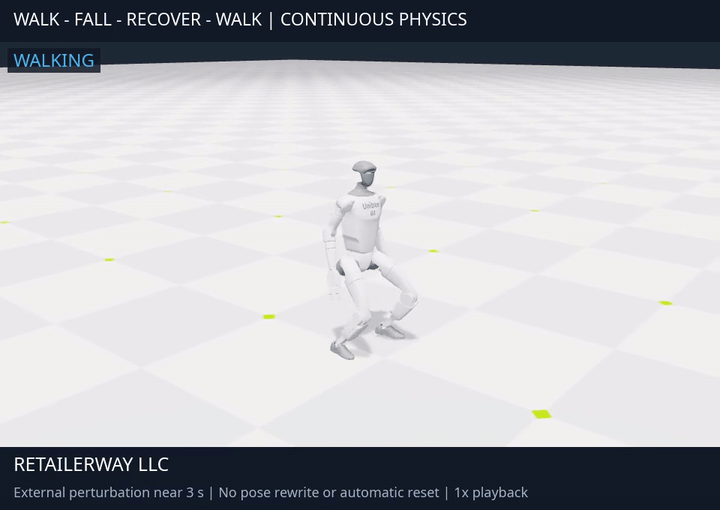
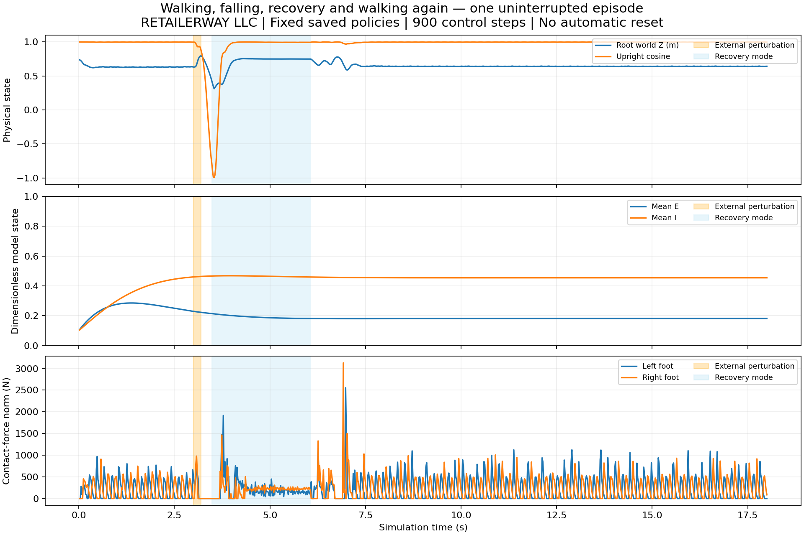
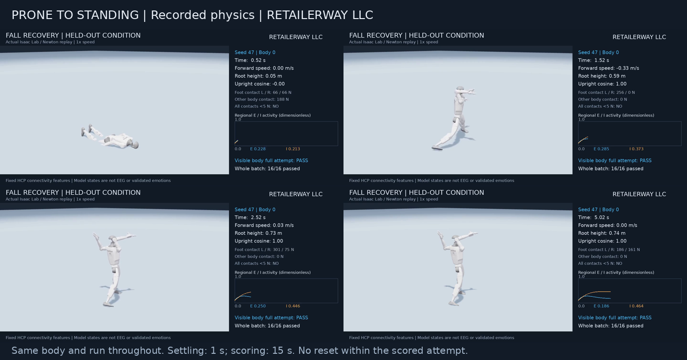

# Motor skills and continuous fall recovery

**RETAILERWAY LLC — November 5, 2026**

The virtual Unitree G1 body now has separate trained policies for running,
ascending a staircase and getting up from the floor. Training used NVIDIA
Isaac Lab / Newton. The fixed 360-region HCP features remain available to
the motor policies; the connectivity matrix itself was not trained.

**Anatomical clarification — November 6:** these results describe a robot.
The G1 asset has a fixed head joint and disabled self-collisions. The earlier
96/96 recovery result verifies its standing task, not natural human recovery
or neck safety. The [articulated human experiment](human-motion.md) is a
separate development branch with explicit head/neck measurements.

| Skill | Primary first attempts | Additional native video conditions |
| --- | --- | --- |
| Running | 40/48 (83.3%) | 12/16 and 14/16; total 66/80 (82.5%) |
| Four physical 8 cm risers | 44/48 (91.7%) | 14/16; total 58/64 (90.6%) |
| Supine to standing | 48/48 | Numeric qualification |
| Prone to standing | 48/48 | A qualification condition includes native video |

Primary conditions used seeds 47, 97 and 131, with 16 bodies each. Recovery
tested both orientations separately, for 96 attempts overall. The training
seed was 7. Evaluation seeds were reused during iterative development:
these are development gates, not an untouched final robustness benchmark.
All retained final-checkpoint conditions, including the 12/16 running batch,
are included in the derived results.

## One uninterrupted walking, falling and recovery episode

[Watch the full 18-second recording](../videos/continuous-fall-recovery.mp4).

An external disturbance near 3 seconds caused a real simulated fall. The
controller selected recovery at step 174 and resumed walking at step 303
after supported standing. All 900 control steps belong to the same episode:
there was no pose rewrite or automatic reset. The disturbance was a
torso-local −300 N X force and −150 N·m Y torque for 0.2 s. This is one
integration example, not a statistical benchmark of arbitrary falls.

Regional E/I state remained continuous through this fall. These are
dimensionless model states, not EEG voltages or evidence of fear, pain,
consciousness or human emotional signaling.

## Skill-specific recordings and acceptance criteria

[Running video](../videos/running-with-activity.mp4) ·
[Stair ascent video](../videos/stairs-with-activity.mp4) ·
[Prone-to-standing video](../videos/recovery-with-activity.mp4).

Running requires mean world-forward speed ≥1.2 m/s after a 2 s warm-up, ≥5%
eligible aerial samples in bouts lasting ≥0.04 s, at least three bouts,
and ≥5% single-leg support from each foot. Both feet and every other body
contact must be below 5 N during flight, with upright cosine ≥0.9, root
height ≥0.55 m and forward speed ≥1 m/s. Resets, stationary hopping,
hand-supported motion and forward bunny-hopping do not qualify.
Across all 80 retained attempts, mean speed was 1.372 m/s against a 1.5 m/s
command, mean eligible aerial fraction was 5.99%, and no body fell.
The published example, body 6 of seed 97, passes its own gate.

The staircase has four physical 0.08 m risers and 0.35 m treads. Bodies
start on the low approach and must climb all four, then hold upright with
foot support for 2 s. Pelvis height must be ≥0.65 m above the 0.32 m
platform, upright cosine ≥0.9, and vertical speed below 0.5 m/s.
Top spawning, descending or teleporting does not count. Four primary
failures involved a fall; successful attempts reached the holding
criterion in a median 6.14 s. The captured batch and visible body 6 pass.

Recovery begins after 1 s of settling, from an observed low, non-upright,
settled body. Standing requires root height ≥0.65 m, upright cosine ≥0.9,
vertical speed below 0.5 m/s and foot support ≥5 N for 2 continuous seconds
within 15 s. Both orientations used the same checkpoint. Median time to
the criterion, including the 2 s hold, was 2.66 s (range 2.60–3.12 s).
The recovery video includes the 1 s settling period and 15 s evaluation.

The group criterion is ≥80% first-attempt success. Full qualification
requires all three evaluation seeds, plus both orientations for recovery.

[Running measurements](../images/running-measurements.png) ·
[Stair measurements](../images/stairs-measurements.png) ·
[Recovery measurements](../images/recovery-measurements.png).

## Verification, decisions and limits

The private skill bank checks checkpoint hashes and observation layouts.
Native runs exercised walking-to-running, recovery-to-walking, stair ascent
and walking-to-fall-to-recovery-to-walking without resetting physics.
The final main suite passed 117 tests, with 25 optional-runtime skips;
the Isaac runtime suite passed 46 tests. An independent code review found
four important issues, fixed with failing-then-passing regressions:
simultaneous fall/timeout accounting, stair command consistency,
support-relative recovery height, and evaluation eligibility including
resets during settling. Upstream source stayed unchanged.

The existing non-Git source project was kept local, with additive files
and retained checkpoints. World-course progress and platform posture were
refined after measured failures; success thresholds were retained.
The climbing milestone is this staircase. Wall/rope climbing, general
autonomous planning and physical-world transfer remain unvalidated.
Publication contents were audited separately from the implementation review.

A deferred presentation limitation is that video panels call world Z
“Root height”; the stair platform is 0.32 m above its approach.
Recovery routing uses height relative to the support surface.

All footage is recorded physics at 1× speed, with English labels and the
RETAILERWAY LLC stamp. The fixed HCP model is not a complete human brain.
A causal benefit from its features, or human electrical/emotional
equivalence, has not been established. Native actuator settings are
simulation settings; no hardware capability is claimed.

Source code, training scripts, weights and raw brain data remain private.
[Derived per-attempt results and provenance hashes](../metadata/motor-skills.json).
