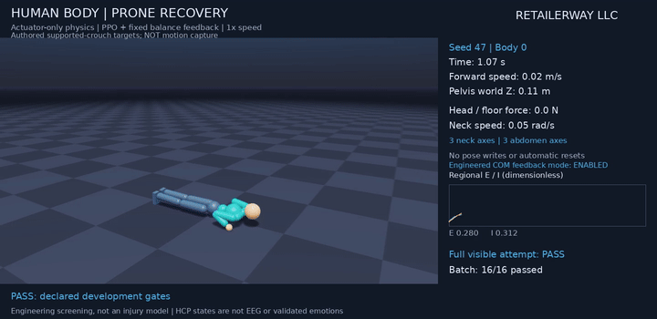
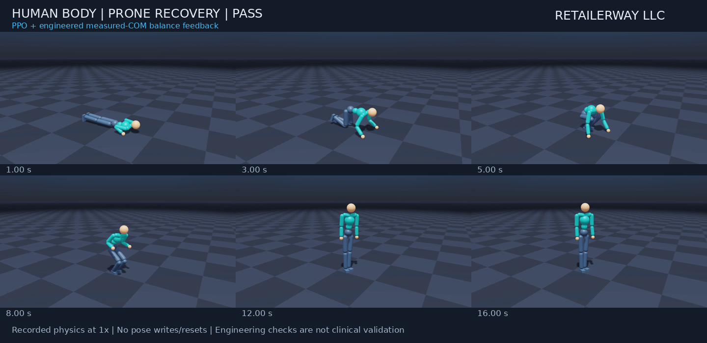
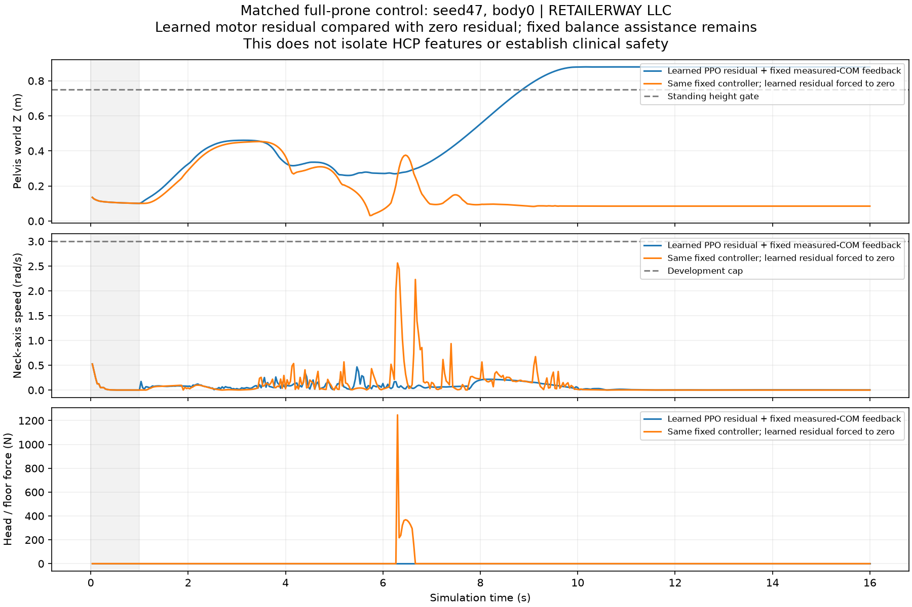

# Supported prone recovery: declared simulation gates passed

**RETAILERWAY LLC — November 6, 2026**

The articulated human research body now completes prone-to-standing recovery
in **48/48 final development attempts**, including the measured head/neck
and joint checks. A separately initialized crouch-to-stand lesson also passed
48/48. The controller combines a **learned PPO motor residual with engineered
measured-COM ankle balance feedback**. This is a simulated-body result;
clinical neck safety, whole-brain modeling and emotional EEG remain unvalidated.

[Full 16-second physics recording](../videos/supported-prone-recovery.mp4) ·
[Measurements](../images/supported-prone-measurements.png) ·
[Derived results and provenance](../metadata/supported-getup.json).

The visible body is body 0 of seed 47 and passes its own complete attempt.
The video includes one second of physical settling followed by 15 seconds
of evaluation, at 1× speed. It contains **no automatic reset, root pose
rewrite or external support** after initialization. The free root has no
actuator; balance assistance changes ankle motor targets only.

## Results and exact scope

| Condition | Actual initial condition | Task + trajectory screen |
| --- | --- | --- |
| Full prone recovery | Observed low, non-upright, settled body | **48/48** |
| Separate crouch-rise lesson | Low bent torso, settled body supported on both feet | **48/48** |
| Matched full-prone control | Same fixed controller, learned motor residual forced to zero | **0/48** |

Each row uses seeds 47, 97 and 131 with 16 bodies per seed. These seeds were
reused during development. They are development conditions, not an untouched
robustness benchmark or 48 human participants. Initial root XY positions
vary by ±0.02 m and joint positions by ±0.01 rad. Ground is flat and initial
heading is fixed. All final-policy conditions are retained in the results.

The full recovery qualifies after a median **10.07 s** of the active
evaluation, including the required two-second supported-standing hold
(range 10.03–10.07 s). In the video, the additional initial settling second
puts qualification at approximately 11.07 s. The crouch lesson qualifies
after a median 4.90 s. It begins at the authored crouch phase and is never
counted as another full prone recovery.

| Scored, 30 Hz measurements | Full prone | Crouch lesson | Unchanged development cap |
| --- | --- | --- | --- |
| Maximum absolute neck hinge speed | 0.497 rad/s | 0.293 rad/s | 3 rad/s |
| Maximum joint-bound excess | 0.0137 rad | 0.0124 rad | 0.02 rad |
| Sustained head-floor support | None | None | Reject >5 N for ≥0.1 s after grace |
| Free-root actuator wrench | 0 | 0 | Root remains unactuated |

These are engineering checks on a compliant research rig, not human injury
thresholds. Samples at 30 Hz do not capture every peak of the 240 Hz physics.
Passing them does not predict fractures or prove that a real person could
safely perform the movement.

## What changed after the failed prototype

The [earlier prototype](human-motion.md) passed 0/48 full attempts. Its main
joint violation was elbow hyperextension under load. Its authored rising
target also lifted the intended support ankle from 0.05 m to approximately
0.187 m after a clearance correction. Static tests showed unstable
intermediate poses; simply training longer against that target was insufficient.

The new authored route passes through prone, hands/knees, supported crouch,
transfer to the feet and standing. Leg IK keeps both target feet planted and
flat during the rising portion. Hand IK preserves floor support during
the transfer and adjusts proposed horizontal hand placement into reachable
space. Pelvis placement keeps the target COM within the support region.
These are authored research targets, **not human motion capture**.
Dense reference checks and actual physical evaluation are separate gates.

An extension-side reserve of 0.08 rad was added to elbow controller targets.
The rig's actual joint limits and the acceptance tolerance were not widened.
Uniformly insetting every joint had broken standing in a development probe,
so that approach was not used. Actual measured excursions continue to count.

The final controller uses fixed ankle feedback from measured whole-body COM
position/velocity and foot support, with a small learned motor residual.
The assistance is gated by reference phase, actual foot load and settling.
An enabled controller mode does not mean the feedback acts during every frame.
Videos and standalone figures disclose the engineered assistance.

The matched zero-residual control uses the same reference, physics, fixed
assistance, initial perturbations and seeds. Its first second of physical
trajectories matches the trained condition within 2 µm in root position
and 2 × 10⁻⁶ rad in joint coordinates before learned actions begin. Only the learned motor residual is
then forced to zero. Its 0/48 result supports the motor residual's importance
in these conditions. It does **not** isolate a benefit from HCP features.

## Training, lessons and recording

Earlier v3 standing and rising lessons used bounded exploration and explicit
reference-phase initialization ranges. The final v3 lesson passed one
16-body crouch condition but failed full-prone recovery. Those lesson
results were kept separate from full-start evaluations.

The final v4 policy was initialized anew; v3 actor weights were **not**
transferred. It trained for 1,500 updates with 512 parallel bodies and
18,432,000 environment steps, seed 7. It retains 491 inputs and 28 motor
outputs, including fixed 360-region HCP features. The connectivity matrix
itself was not trained. The exact private reference was archived and its
hash/profile checked when loading checkpoints. Exploration remained bounded.

[Separate crouch-rise video](../videos/crouch-to-stand.mp4) ·
[Crouch sequence](../images/crouch-to-stand-sequence.png) ·
[Crouch measurements](../images/crouch-to-stand-measurements.png).
Its labels explicitly say that it is a later-start lesson, not full recovery.

All shared physical footage is a replay of the saved controller in Newton,
with actual control steps matched to physical and regional E/I telemetry.
The curves remain dimensionless model states, not EEG voltage, fear, pain
or validated emotion. No posed reference animation is used as physical proof.

## Verification and remaining limits

The unchanged full-recovery gate requires a settled low, non-upright start,
then pelvis height ≥0.75 m, root and torso upright cosines ≥0.9, vertical
speed below 0.5 m/s and foot support for two continuous seconds within 15 s.
Any termination, including settling, or discontinuous episode age invalidates
the first attempt. The distinct crouch lesson additionally checks its
observed two-foot support and bent torso at initialization.

The main suite passed 139 tests with 46 optional-runtime skips. The
simulation-compatible suite passed 178 tests; six existing neuroimaging
test files requiring absent dependencies were covered in the main environment
and excluded there. Counts overlap. After review fixes, 43 focused tests
passed, and actual standalone image OCR checks failed before the attribution
fix and passed afterward. Review also checked dense reference interpolation.

Runtime checks verify that elbow reserves do not change physical stops,
curriculum ranges cannot affect full-start initialization, COM velocity uses
the correct runtime convention, and a fall at a timeout is not bootstrapped
as a pure time truncation. An independent review's image-attribution findings
were corrected before publication. Media decoding, branding and publication
integrity are audited separately from physical success.

This starts from an initialized prone pose. It does not demonstrate an
unexpected fall followed by autonomous recovery routing, resumed human-body
walking, new human-body running/climbing, general terrain robustness or
physical-world transfer. Human-body walking remains at the earlier
experimental status. Motion naturalness has not been scored against human
motion capture, and the rig is not a clinical musculoskeletal injury model.

The old G1 policies, earlier failed human prototypes and evidence remain
preserved. Only English media, reports and derived numerical summaries are
shared, with RETAILERWAY LLC branding. Source, scripts, configurations,
weights and raw motion/brain/EEG traces remain private.
[Sources](sources.md) · [Publication scope](../PUBLICATION.md).
